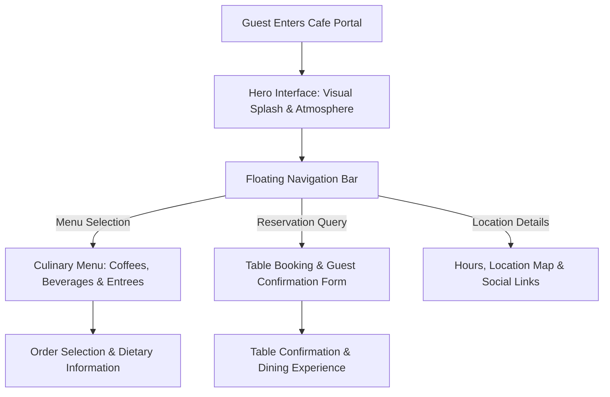

<div align="center">


[](https://developer.mozilla.org/en-US/docs/Web/HTML)
[](https://developer.mozilla.org/en-US/docs/Web/CSS)
[](#)
[](#)
[](#)

</div>

---

## 📌 Executive Summary / Overview

**Food Cafe Hospitality Portal** (`FSD_FoodCafe`) is a modern dining and culinary web interface engineered to deliver an atmospheric, visual-first customer booking experience. Created as part of Full Stack Development (FSD) curriculum, the project combines ambient hospitality visual design with structured navigational pathways.

The hospitality sector requires high sensory immersion: ambient photography, clear dietary categorization, transparent pricing, and instant reservation pathways. This repository implements translucent frosted backdrops, responsive CSS Flexbox alignments, elegant contrast typography, and structured menu groupings that simulate a high-end cafe and bistro portal.

---

## 📖 Interactive Table of Contents

- [Executive Summary / Overview](#-executive-summary--overview)
- [Key Features & Capabilities](#-key-features--capabilities)
- [System Architecture & Guest Experience Flow](#-system-architecture--guest-experience-flow)
- [Tech Stack Breakdown](#-tech-stack-breakdown)
- [Culinary Menu Architecture](#-culinary-menu-architecture)
- [Reproducible Quickstart & Setup](#-reproducible-quickstart--setup)
- [Project Directory Layout](#-project-directory-layout)
- [Author & Contributions](#-author--contributions)

---

## ✨ Key Features & Capabilities

- **Translucent Floating Header**: Semi-transparent dark frosted glass navigation bar featuring brand typography, interactive pseudo-class hover effects (`:hover`), and anchor navigation.
- **Full-Viewport Visual Hero**: Immersive full-screen background splash view creating immediate culinary atmosphere with centered headline framing.
- **Categorized Culinary Menu**: Modular layout displaying cafe specialties, beverages, artisanal coffees, bakery desserts, and gourmet entrees.
- **Table Reservation & Contact Pathways**: Direct action triggers connecting guests to dining reservations and location mapping.
- **Responsive Flexbox Architecture**: Dynamically adjusts visual cards and container boundaries across mobile, tablet, and desktop viewports.

---

## 🏗️ System Architecture & Guest Experience Flow



---

## 🛠️ Tech Stack Breakdown

| Category | Technologies & Tools |
| :--- | :--- |
| **Markup Language** | HTML5 (Semantic Tags, Container Divs, Responsive Elements) |
| **Styling & Effects** | CSS3 (Flexbox, RGBA Transparency, Hover Transitions, Hero Scaling) |
| **Typography & Imagery** | Web Fonts, High-Resolution Food Assets |
| **Browsers Supported** | Chrome, Firefox, Safari, Edge |

---

## ☕ Culinary Menu Architecture

| Menu Category | Featured Offerings | Key Culinary Highlights |
| :--- | :--- | :--- |
| **Artisanal Coffee** | Espresso, Cappuccino, Flat White, Cold Brew | Single-origin beans, oat milk customization |
| **Gourmet Bakery** | Croissants, Pain au Chocolat, Danish Pastries | Fresh daily in-house baked viennoiserie |
| **Savory Bistro** | Avocado Toast, Gourmet Paninis, Seasonal Bowls | Organic, locally sourced farm-to-table ingredients |
| **Signature Beverages**| Matcha Lattes, Herbal Tisanes, Fresh Fruit Smoothies | Zero artificial syrups, antioxidant rich |

---

## 🚀 Reproducible Quickstart & Setup

### Prerequisites
- Modern web browser

### Step 1: Clone the Repository
```bash
git clone https://github.com/Jeshwanthika07/FSD_FoodCafe.git
cd FSD_FoodCafe
```

### Step 2: Open in Browser
```bash
# On Windows
start "food cafe updated.html"

# On macOS
open "food cafe updated.html"

# On Linux
xdg-open "food cafe updated.html"
```

---

## 📂 Project Directory Layout

```text
FSD_FoodCafe/
│
├── food cafe updated.html     # Primary restaurant web page and inline CSS styling
└── README.md                  # Comprehensive hospitality portal documentation
```

---

## 👩‍💻 Author & Contributions

Authored by **[Jeshwanthika Pothamchetty](https://github.com/Jeshwanthika07)**  
*Alliance University | Department of Computer Applications*

<div align="center">


</div>
